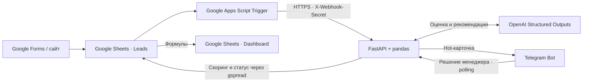

# AI CRM на базе Google Sheets

CRM для B2B-продаж и услуг, в которой команда ведёт заявки в привычной таблице. FastAPI оценивает лид по источнику, бюджету и активности, предлагает следующий шаг и готовит черновик первого сообщения. Горячие заявки сразу попадают в Telegram. Менеджер берёт лид в работу или отмечает его нецелевым прямо из карточки.

Dashboard показывает объём воронки, бюджет Hot-лидов и эффективность источников. Эти показатели дают исходные данные для прогноза продаж. Время создания заявки и первого решения менеджера позволяют измерять скорость реакции и сверять её с целевым SLA.

## Было → Стало

| Было | Стало |
| --- | --- |
| Менеджер читает все заявки в порядке поступления | Hot, Warm и Cold задают приоритет, а Hot-лиды приходят в Telegram |
| Первое сообщение и план действий пишутся с нуля | Менеджер получает черновик, следующий шаг и риски для проверки |
| Бюджеты и источники сводятся вручную | Dashboard пересчитывает воронку и разбивку по источникам по данным Leads |
| Время реакции приходится искать в переписке | Первый ответ через карточку фиксирует статус и время в таблице |

В сквозной демонстрации обработано 25 вымышленных лидов. OpenAI оценил четыре новых заявки, две Hot-карточки доставлены в Telegram. После скоринга Dashboard показал 6 635 000 ₽ общего бюджета и 5 242 000 ₽ бюджета Hot-лидов. Это данные демонстрационной воронки.

## Документация проекта

- [Техническое задание (DOCX)](docs/Техническое_задание_AI_CRM_Google_Sheets.docx) — описание системы, целевая аудитория и её боли, функциональные требования, матрица ограничений и рисков, критерии приёмки.
- [Бизнес-кейс для портфолио (DOCX)](docs/Бизнес_кейс_AI_CRM_Google_Sheets.docx) — решаемые задачи, пошаговая архитектура, метрики эффективности («Было → Стало») и результаты демонстрации.

## Архитектура



Для Google Forms сопоставьте поля формы с колонками `Leads` и вызовите вебхук после записи строки. Сайт или другая интеграция, которая пишет через Sheets API, вызывает `/score-row` сама. Скрипт из репозитория устанавливает триггеры для ручных правок и вставки строк в таблице.

## Развёртывание

### 1. Создайте сервисный аккаунт и таблицу

1. Создайте проект в Google Cloud и включите **Google Sheets API** через **APIs & Services → Library**.
2. В **IAM & Admin → Service Accounts** создайте сервисный аккаунт. На вкладке **Keys** создайте JSON-ключ и сохраните его как `secrets/google-service-account.json`.
3. Создайте Google-таблицу. Дайте адресу `client_email` из JSON доступ **Редактор** и скопируйте ID таблицы из части URL между `/d/` и `/edit`.

### 2. Заполните `.env`

Скопируйте [`.env.example`](.env.example) в `.env` и заполните настройки.

| Переменная | Значение |
| --- | --- |
| `GOOGLE_SHEETS_CREDENTIALS_PATH` | Путь к JSON-ключу, например `./secrets/google-service-account.json` |
| `SPREADSHEET_ID` | ID Google-таблицы |
| `OPENAI_API_KEY` | Ключ OpenAI API |
| `TELEGRAM_BOT_TOKEN` | Токен от BotFather |
| `TELEGRAM_CHAT_ID` | Числовой ID чата. Для личного чата нажмите **Start**, для группы добавьте бота и разрешите ему отправлять сообщения |
| `WEBHOOK_SECRET` | Случайная строка, например результат `python -c "import secrets; print(secrets.token_hex(32))"` |

Параметры по умолчанию включают листы `Leads` и `Dashboard`, модель `gpt-4o-mini` и порог Hot 75. `OPENAI_BASE_URL` заполняется при использовании совместимого API. Храните `.env` и JSON-ключ локально.

### 3. Инициализируйте листы и запустите сервис

**Docker Compose**

```sh
docker compose build
docker compose run --rm crm python -m scripts.setup_demo
docker compose up -d crm
```

В Linux пользователь контейнера с UID 10001 должен иметь доступ на чтение к смонтированному JSON-файлу.

**Python 3.12**

```powershell
python -m venv .venv
.\.venv\Scripts\python.exe -m pip install -r requirements.txt
.\.venv\Scripts\python.exe -m scripts.setup_demo
.\.venv\Scripts\python.exe -m uvicorn app.main:app --host 127.0.0.1 --port 8000 --workers 1
```

На macOS и Linux используйте `.venv/bin/python`. Выберите один способ запуска, чтобы один бот обслуживался одним процессом polling.

Команда настройки загружает 25 вымышленных лидов на пустой лист. У 21 лида есть оценки, четыре готовы к скорингу. Флаг `--empty` инициализирует листы без демоданных. Флаг `--replace-leads` перезаписывает A:P листа Leads. Остановите CRM перед такой заменой.

### 4. Подключите Apps Script

1. Для демонстрации запустите `cloudflared tunnel --url http://127.0.0.1:8000`. Скопируйте полученный адрес `https://….trycloudflare.com` и оставьте туннель запущенным. Новый Quick Tunnel получает новый адрес. Для постоянной установки используйте стабильный HTTPS-адрес.
2. В Google Sheets откройте **Расширения → Apps Script** и вставьте содержимое [`gas/Code.gs`](gas/Code.gs) в `Code.gs`.
3. В **Настройки проекта → Свойства скрипта** задайте `CRM_BASE_URL` (публичный HTTPS-адрес без завершающего слэша), `WEBHOOK_SECRET` (то же значение, что в `.env`) и `LEADS_SHEET_NAME` (по умолчанию `Leads`).
4. Выполните `installCrmTriggers` из редактора и выдайте разрешения. Установку выполняет один ответственный редактор.
5. Обновите страницу таблицы и выберите **🤖 AI CRM → Пересчитать необработанные лиды**. Проверьте оценки в Leads и новые значения в Dashboard. Для проверки одиночного вебхука измените `Activity` у демолида и проверьте `Scored_At`.

## HTTP API

Все запросы используют заголовок `X-Webhook-Secret`.

| Метод | Маршрут | Результат |
| --- | --- | --- |
| GET | `/health` | Состояние процесса polling и прогресс текущего или последнего пакетного запуска |
| POST | `/score-row` | `{"row_index": 2}`. Повторный расчёт одной строки с актуальными данными |
| POST | `/score-all` | HTTP 202. Фоновый скоринг строк без оценки и повтор отправки ожидающих Hot-карточек |
| POST | `/refresh-dashboard` | Создание или обновление формул KPI и сводки по источникам |
| POST | `/simulate-lead` | Добавление случайного демолида и немедленный скоринг. При ошибке после вставки ответ содержит его ID |

Пример проверки из PowerShell после загрузки секрета в переменную окружения текущей сессии.

```powershell
Invoke-RestMethod -Uri 'http://localhost:8000/health' -Headers @{'X-Webhook-Secret' = $env:WEBHOOK_SECRET}
```

## Данные и эксплуатация

Имена, контакты, компании и обращения в демонстрационной базе вымышлены. Совпадения случайны. Перед использованием с реальными заявками проверьте правила доступа к таблице и обработки данных в OpenAI и Telegram.

- Заполняйте `Name`, `Contact`, `Source`, `Budget` и `Activity`. Бюджет вводите числом в рублях, при неизвестном бюджете оставляйте пустым. CRM назначает ID и время создания новым строкам, затем записывает оценку и рекомендации. Время хранится в UTC в формате ISO 8601.
- Источник даёт до 20 баллов, бюджет до 30, активность до 50. Порог Hot задаёт `HOT_LEAD_THRESHOLD`, Warm начинается с 45 баллов для лидов ниже порога Hot. В OpenAI передаются имя, источник, бюджет и комментарий. Поле контакта используется в Telegram-карточке.
- Dashboard пересчитывает формулы по текущим значениям Leads. KPI считают строки с ID. В «Сумму воронки» входит весь их бюджет, включая закрытые строки. Сводка группирует заполненные источники. «Неразобранные Hot-лиды» исключает статусы «В работе» и «Отказ».
- Один экземпляр Uvicorn с одним worker сериализует изменения сервиса и запускает один Telegram poller. Первый обработанный клик фиксирует статус и время, следующие клики используют сохранённый результат. Статус пакетного запуска хранится в памяти. После перезапуска его можно запустить повторно.
- Сервис повторяет запросы при Google API 429 и повторно сверяет ID и поля скоринга перед записью. Sheets API использует адреса строк при записи, поэтому массовые сортировки и перемещения строк выполняйте вне активных запусков.
- После подтверждения Telegram сервис сохраняет `Notified=TRUE` и пропускает последующие уведомления. В случае сбоя записи процесс помнит подтверждённую отправку до перезапуска. При падении между отправкой и записью либо сетевом таймауте Telegram возможна повторная карточка при следующей обработке.
- Если Telegram вернул `Chat not found`, проверьте числовой `TELEGRAM_CHAT_ID` и доступ бота к чату. В личном чате сначала нажмите Start. После правки `.env` выполните `docker compose up -d crm` и запустите `/score-all` повторно, чтобы отправить ожидающие Hot-карточки с уже сохранёнными оценками.
- Apps Script обрабатывает пользовательские правки. При вставке пустой строки скоринг начинается после ввода данных. Интеграции, которые пишут в Sheets через API, должны явно вызывать `/score-row` или `/score-all`.

[OpenAI Structured Outputs](https://developers.openai.com/api/docs/guides/structured-outputs?api-mode=chat) · [События Apps Script](https://developers.google.com/apps-script/guides/triggers/events) · [Cloudflare Quick Tunnels](https://developers.cloudflare.com/tunnel/get-started/quick-tunnels/)
